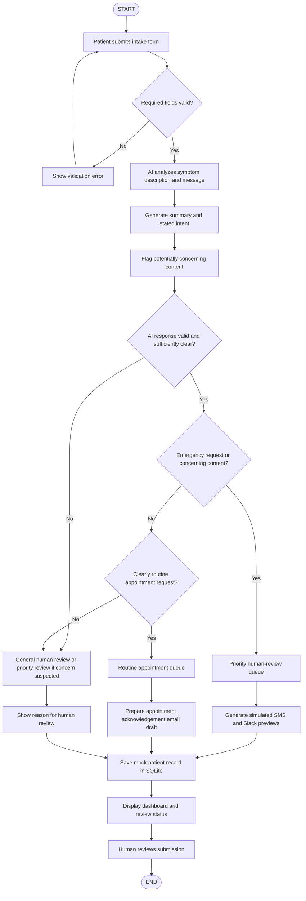

# System Architecture Flowchart

This document details the intake, analysis, routing, and escalation lifecycle for the **AI-Powered Medical Intake & Escalation Workflow** prototype.

## Mermaid Workflow Diagram

## Detailed Stage Breakdown

### 1. Form Ingestion & Validation
- **Inputs**: Patient Full Name, Contact Details (fictional), Symptoms Description, and Patient Free-Text Message.
- **Rule**: If any mandatory field (`Name`, `Symptoms`, `Message`) is empty or contains insufficient length, submission is rejected with actionable UI feedback before processing.

### 2. AI / Conservative Fallback Analysis
- **Primary Engine**: Google Gemini API (`gemini-2.5-flash`) via structured JSON schema output with strict system constraints.
- **Fallback Engine**: Offline conservative regex heuristics engine activated if no API key is detected or if an API network timeout/quota error occurs.
- **Outputs**:
  - `summary`: Factual condensation of patient-reported symptoms and inquiry without hallucination.
  - `stated_intent`: Exactly one of `EMERGENCY_REQUEST`, `ROUTINE_APPOINTMENT`, or `OTHER_OR_UNCLEAR`.
  - `priority_human_review`: Boolean (`True` / `False`) indicating presence of potentially concerning clinical content.
  - `review_reason`: Plain-text rationale grounded directly in reported symptoms.

### 3. Deterministic Routing Rules
- **Rule A (Emergency Override)**: If `stated_intent == "EMERGENCY_REQUEST"`, route directly to `PRIORITY_HUMAN_REVIEW`.
- **Rule B (Safety Priority Flag)**: If `priority_human_review == True`, route directly to `PRIORITY_HUMAN_REVIEW`, overriding any stated routine or unclear intent (e.g. acute facial drooping or chest tightness casually mentioned during an appointment request).
- **Rule C (Clear Routine)**: If `stated_intent == "ROUTINE_APPOINTMENT"` and `priority_human_review == False`, route to `ROUTINE_APPOINTMENT`.
- **Rule D (Ambiguity / Failure)**: If `stated_intent == "OTHER_OR_UNCLEAR"`, AI output is malformed, or API analysis fails:
  - If concerning content is suspected $\rightarrow$ `PRIORITY_HUMAN_REVIEW`.
  - Otherwise $\rightarrow$ `GENERAL_HUMAN_REVIEW`.
- **Rule E (No Negative Inference)**: System never interprets the absence of emergency keywords as proof that a patient is clinically safe.
- **Rule F (Fail-Safe Default)**: When analysis fails, system never silently routes as routine.

### 4. Workflow Actions & Simulations
- **Priority Queue**:
  - Immediate red banner escalation.
  - Simulated SMS dispatch to On-Call Nurse Triage (`+1-555-0199`).
  - Simulated Slack priority escalation card in `#clinical-escalations-priority`.
- **Routine Queue**:
  - Empathetic appointment acknowledgement email draft with safety disclaimer reminders.
  - Draft state preserved until clinic scheduler approves.
- **General Queue**:
  - Staff clarification notice and simulated Slack post in `#intake-general-review`.

### 5. Persistence & Human Oversight
- Every record is saved to local SQLite (`intake_workflow.db`) using parameterized SQL queries.
- Records remain persistently accessible in the Reviewer Dashboard with queue filtering, record inspection, CSV export, and review status tracking (`Pending Review`, `Under Review`, `Actioned`, `Dismissed`).
