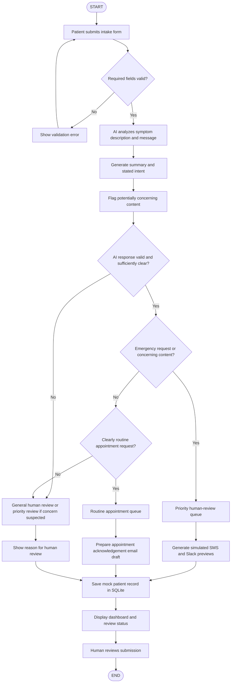

# 🚀 AI-Powered Medical Intake & Escalation Workflow 

[](https://github.com/Roobika06/ai-medical-intake-workflow)

[](https://www.python.org/)
[](https://pytest.org/)
[](#safety--medical-disclaimer)

> 👤 **Author:** Roobika ([@Roobika06](https://github.com/Roobika06))  
> 📂 **GitHub Repo:** [https://github.com/Roobika06/ai-medical-intake-workflow](https://github.com/Roobika06/ai-medical-intake-workflow)

An educational healthcare workflow automation prototype. This application simulates how modern digital health platforms can safely ingest, summarize, categorize, and escalate patient messages without ever compromising patient safety.

---

## ⚠️ Safety & Medical Disclaimer

> **CRITICAL CLINICAL NOTICE:**  
> This project is strictly an **educational prototype and demonstration tool** developed for candidate recruitment assessment.
> - **All data is fictional.** No actual patients, medical providers, or emergency services are contacted.
> - **Simulated Notifications Only.** All SMS, Slack, and email previews are generated strictly within the user interface; no live networks, Twilio, or external messaging APIs are used.
> - **Not a Clinical Device.** The system **does not diagnose, prescribe treatment, or provide clinical triage**.
> - **Core Safety Invariant:** The system **NEVER treats the absence of emergency keywords as proof that a patient is clinically safe**.
> - In an actual medical emergency, call 911 or visit the nearest emergency room immediately.

---

## 📋 System Architecture & Workflow Flowchart

The workflow separates unstructured natural language understanding (via Google Gemini AI or an offline conservative fallback) from deterministic Python routing rules.



---

## 🧠 Deterministic Routing Rules

Routing decisions are governed by Python logic independent of the AI model's internal representations:

1. **Rule A (Emergency Override):** If the patient explicitly requests emergency assistance (`EMERGENCY_REQUEST`), the record is sent directly to the **Priority Human-Review Queue**.
2. **Rule B (Safety Priority Override):** If the AI or heuristic engine flags potentially concerning clinical content (`priority_human_review == True`), the record is sent to the **Priority Human-Review Queue** even if the patient's stated intent is routine or unclear (e.g. casual inquiry accompanied by acute facial droop or chest pressure).
3. **Rule C (Clear Routine):** If the stated intent is clearly a routine appointment request (`ROUTINE_APPOINTMENT`) and **no concern is detected**, the record routes to the **Routine Appointment Queue**.
4. **Rule D (Ambiguity & Fail-Safe):** If the message is ambiguous (`OTHER_OR_UNCLEAR`), the AI response is invalid, or the analysis fails:
   - If concerning content is suspected $\rightarrow$ **Priority Human-Review Queue**.
   - Otherwise $\rightarrow$ **General Human-Review Queue**.
5. **Rule E (No Negative Inference):** The absence of emergency keywords is **never** interpreted as medical clearance.
6. **Rule F (No Silent Fallback to Routine):** Analysis failures or API errors **never** silently route as routine.

*Note: These routing rules are illustrative software demonstrations and are not clinically validated triage algorithms.*

---

## 💻 Windows Setup Instructions (Step-by-Step)

Follow these exact instructions to set up, configure, and launch the application on Windows 10 or 11.

### Prerequisites
- Python 3.11 or newer installed from [python.org](https://www.python.org/downloads/).
- Ensure **"Add Python to PATH"** is checked during installation.
- Git for Windows (optional, for cloning).

---

### Method A: Using Windows PowerShell (Recommended)

1. **Open PowerShell as standard user:**
   Press `Win + X` and select **Windows PowerShell** or **Terminal**.

2. **Clone or navigate to the project repository:**
   ```powershell
   cd C:\Users\YourUsername\Projects\ai-medical-intake
   ```

3. **Create a clean virtual environment:**
   ```powershell
   python -m venv venv
   ```

4. **Activate the virtual environment:**
   ```powershell
   .\venv\Scripts\Activate.ps1
   ```
   *Note: If PowerShell displays an `Execution_Policies` script error, allow local script execution by running:*
   ```powershell
   Set-ExecutionPolicy -ExecutionPolicy RemoteSigned -Scope CurrentUser
   .\venv\Scripts\Activate.ps1
   ```

5. **Upgrade pip and install dependencies:**
   ```powershell
   python -m pip install --upgrade pip
   pip install -r requirements.txt
   ```

6. **Configure Environment Variables (Optional):**
   Copy `.env.example` to `.env`:
   ```powershell
   Copy-Item .env.example .env
   ```
   *If you have a Google Gemini API key, open `.env` in Notepad and insert it:*
   ```ini
   GEMINI_API_KEY="your_actual_gemini_api_key_here"
   ```
   *(If no key is configured, the application automatically runs in **Conservative Fallback Mode** with complete safety heuristics).*

7. **Run automated test suite:**
   ```powershell
   python -m pytest tests/test_routing.py -v
   ```

8. **Launch the Streamlit web application:**
   ```powershell
   streamlit run app.py
   ```
   Your default web browser will automatically open: `http://localhost:8501`

---

### Method B: Using Windows Command Prompt (CMD)

1. **Open Command Prompt (`cmd.exe`):**
   Press `Win + R`, type `cmd`, and press Enter.

2. **Navigate to the workspace directory:**
   ```cmd
   cd C:\Users\YourUsername\Projects\ai-medical-intake
   ```

3. **Create and activate virtual environment:**
   ```cmd
   python -m venv venv
   venv\Scripts\activate.bat
   ```

4. **Install dependencies:**
   ```cmd
   python -m pip install --upgrade pip
   pip install -r requirements.txt
   ```

5. **Run test suite:**
   ```cmd
   python -m pytest tests/test_routing.py -v
   ```

6. **Launch the web application:**
   ```cmd
   streamlit run app.py
   ```

---

## 🧪 Automated Testing

Automated tests are located in `tests/test_routing.py`. All tests use mock objects so they run instantly **offline without requiring an internet connection or an API key**.

To run tests:
```bash
python -m pytest tests/test_routing.py -v
```

### Verified Test Conditions:
- ✅ **Test 1:** Explicit emergency request routes to Priority Human Review (`Rule A`).
- ✅ **Test 2:** Concerning-content flag overrides routine intent (`Rule B`).
- ✅ **Test 3:** Clear routine request routes to Routine Appointment only when no concern is detected (`Rule C`).
- ✅ **Test 4:** Unclear/ambiguous request routes to General Human Review (`Rule D`).
- ✅ **Test 5:** Unclear request with suspected concern routes to Priority Review.
- ✅ **Test 6:** Invalid AI response never silently routes as routine (`Rule F`).
- ✅ **Test 7:** Form validation rejects missing patient name, whitespace-only names, missing symptoms, or empty messages.
- ✅ **Test 8:** AI API timeouts or network errors activate safe offline fallback handling.
- ✅ **Test 9:** A message containing the word `"emergency"` in a negated context (`"This is not an emergency..."`) is NOT blindly classified as an emergency.
- ✅ **Test 10:** Subtle neurological red flags (facial droop, slurred speech) trigger priority escalation even without explicit emergency keywords.

---

## 📁 Repository Structure

```
├── app.py                      # Streamlit interactive application & dashboard
├── triage_engine.py            # Core validation, AI analysis, fallback heuristics, routing, SQLite
├── requirements.txt            # Python dependencies (streamlit, pandas, pytest, etc.)
├── FLOWCHART.md                # System Mermaid architecture & workflow documentation
├── PROMPT_DOCUMENTATION.md     # Detailed prompt breakdown, test cases, and iterations
├── VIDEO_SCRIPT.md             # 2-3 minute presentation script for assessment demonstration
├── tests/
│   └── test_routing.py         # 19 automated Pytest unit and regression tests
├── .env.example                # Safe environment variable configuration template
├── .gitignore                  # Git exclusions for Python, SQLite .db, and secrets
└── README.md                   # Complete system documentation and setup guide
```

---

## 🚀 Live Demonstration Walkthrough

When evaluating or recording the application:

1. **Start the App:** `streamlit run app.py`
2. **Review Top Banner:** Observe the safety notice and engine status (`Gemini 2.5 Flash Active` or `Conservative Fallback Mode`).
3. **Explore Tab 1 (Patient Intake Form):**
   - Use the **Quick-load Test Scenarios** dropdown:
     - **Scenario 1:** Observe immediate SMS & Slack priority escalation for crushing chest pain.
     - **Scenario 2:** Observe routine appointment queue routing with empathetic email draft.
     - **Scenario 3:** Observe red-flag override (facial droop casually mentioned routes to priority review).
     - **Scenario 5:** Observe negation handling (*"This is NOT an emergency..."* correctly classified as routine).
4. **Explore Tab 2 (Triage Queues & Dashboard):**
   - Filter between Priority, Routine, and General queues.
   - Inspect individual patient records, summaries, and clinical rationales.
   - Update a patient's triage status (`Pending Review` $\rightarrow$ `Under Review` $\rightarrow$ `Actioned`).
5. **Explore Tab 3 (System Management):**
   - Click **Download All Submissions (CSV)** to export data.
   - Click **Load 5 Educational Preset Scenarios** or **Confirm Database Reset** to re-seed.

---

## 🔧 Troubleshooting Guide

| Issue | Cause | Solution |
| :--- | :--- | :--- |
| `pip: command not found` | Python was not added to Windows PATH during install. | Re-run Python installer, select "Modify", and check "Add Python to environment variables". |
| `cannot be loaded because running scripts is disabled` | PowerShell script execution policy restriction. | Run `Set-ExecutionPolicy -ExecutionPolicy RemoteSigned -Scope CurrentUser` in PowerShell. |
| `ModuleNotFoundError: No module named 'triage_engine'` | Running pytest from outside project root. | Run `python -m pytest tests/test_routing.py -v` (which includes current directory in python path). |
| `Port 8501 is already in use` | Another Streamlit instance is running. | Run `streamlit run app.py --server.port 8502`. |
| Missing Gemini API Key | `.env` not configured. | The system automatically falls back to offline rule-based mode. To use Gemini, add `GEMINI_API_KEY="your_key"` in `.env`. |

---

## 📤 Publishing to GitHub (`https://github.com/Roobika06`)

To publish this repository to your personal GitHub account:

### Step 1: Create a New Repository on GitHub
1. Go to [https://github.com/new](https://github.com/new).
2. Set **Repository name**: `ai-medical-intake-workflow` (or your preferred name).
3. Set visibility to **Public** (recommended so assessors can see it).
4. Leave "Add a README", ".gitignore", and "License" **unchecked** (our project already contains all of them).
5. Click **Create repository**.

### Step 2: Push Your Code
Open your terminal (PowerShell, Command Prompt, or bash) in the project directory and run:

```bash
# 1. Initialize git (if not already done)
git init

# 2. Stage all project files
git add .

# 3. Create initial commit
git commit -m "feat: complete AI medical intake and escalation workflow prototype"

# 4. Set default branch to main
git branch -M main

# 5. Link to your GitHub repository
git remote add origin https://github.com/Roobika06/ai-medical-intake-workflow.git

# 6. Push to GitHub
git push -u origin main
```

### Step 3: Add the Live Demo Link to Your GitHub Repository
1. In your GitHub repository page (`https://github.com/Roobika06/ai-medical-intake-workflow`), click the **⚙️ (Edit repository details)** button near the top right of the code tab (under the "About" section).
2. In the **Website** field, paste your live demo URL:
   ```
   https://ais-pre-s6n67q6wz3k3jvht6cp25e-222760784642.asia-east1.run.app
   ```
3. Add topics: `healthcare`, `ai-triage`, `python`, `streamlit`, `safety-first`, `gemini-api`.
4. Click **Save changes**.
